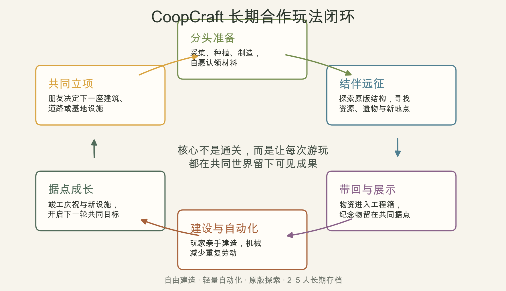

# CoopCraft 长期内容目标与开发路线调研

> 调研日期：2026-10-26 
> 适用项目：Minecraft 1.21.1、Fabric、2–5 人私密长期存档 
> 当前基础：合作便利功能、自动农艺机，以及开发中的机械钻头与物品传送带 
> 文档性质：内容方向与优先级决策，不是要求一次做完的功能清单

## 执行摘要

CoopCraft 的长期目标确定为：**让 2–5 位朋友围绕一个共同据点，自由建造、结伴远征，并用轻量自动化减少重复劳动，使每次游玩都在长期世界中留下可见成果。**它不是以击败最终 Boss 为终点的任务包，也不是复制一套大型工业或殖民地系统。混合主题通过同一个据点自然汇合：机械服务生产，农业服务生活，探索服务发现，收藏与建筑服务表达，合作系统把这些活动变成朋友共同完成的事情。

当前机械物流完成后，下一项优先开发**“共同工程”系统**，而不是继续添加孤立机器。最小版本由“工程公告板＋工程箱＋共享竣工播报”组成：玩家创建建筑或设施项目，列出所需材料，自愿捐献，所有人看到进度，完成后共同庆祝。它能立即把现有农场、钻头、传送带和合作播报接入同一条玩法闭环，也是后续远征、烹饪、村落和收藏内容的共同入口。

## 1. 目标与设计边界

### 1.1 核心体验

CoopCraft 的核心不是“让玩家拥有更多方块”，而是**让几个朋友有理由持续回到同一个世界**。一次典型游玩可以是：有人提出建一座车站，大家列出材料；一人整理农场和产线，两人外出寻找遗迹与稀有装饰；回来后把物资放入工程箱，一起完成主体建设。下一次游玩则由新车站引出更远的探索。这个循环允许单人推进，但多人参与会更丰富、更轻松，而不是被强制分配职业。

长期目标应同时容纳“今天想战斗”“今天想种田”和“今天只想盖房子”三种状态。系统只提供方向、记录和协作便利，不用每日任务、连续登录、限时惩罚或资源枯萎强迫玩家上线。每个版本都应该加强“共同世界的可见变化”，而不是只增加一份更长的物品清单。

### 1.2 明确不做的事情

| 不优先或不采用 | 原因 |
| --- | --- |
| 完整能源网络、复杂动力与多级工业树 | 开发和教学成本高，也会与 Create 等大型科技模组正面重叠 |
| 大型 NPC 殖民地、居民 AI 与自动盖楼 | 会取代玩家建造，且寻路、持久化和服务端开销风险高 |
| 强制职业、等级、技能点和固定队伍角色 | 不符合朋友间随时换活动的自由玩法 |
| 饥渴、温度、每日需求等持续惩罚 | 长期存档容易从共同建设变成共同维护负担 |
| 数百个任务、食物或仅数值不同的装备 | 内容数量增加不等于合作体验增强 |
| 全图无线存取与永久区块加载 | 会削弱道路、运输和据点布局的意义，也增加性能风险 |
| 一开始制作大量原创结构或 Boss | 资产、测试与平衡成本高，且当前原版结构尚未被充分利用 |

这些边界不是永久禁令，而是防止项目在早期失去辨识度。只有当核心闭环经过真实游玩验证，并明确出现“现有内容无法解决的问题”时，才应扩大系统规模。

## 2. 调研结论：哪些机制值得利用

### 2.1 原版 1.21.1 已经提供的合作基础

试炼密室的试炼刷怪笼会依据周围玩家数量调整挑战，宝库则记录玩家独立解锁资格；这使多人远征天然具有参与感和个人奖励，不需要 CoopCraft 另造一套地牢框架。[^1^](https://zh.minecraft.wiki/w/%E8%AF%95%E7%82%BC%E5%88%B7%E6%80%AA%E7%AC%BC)[^2^](https://zh.minecraft.wiki/w/%E4%B8%8D%E7%A5%A5%E5%AE%9D%E5%BA%93) 更值得补位的是远征前后的合作：共同决定去哪里、准备什么、如何标记地点，以及把什么纪念品和材料带回基地。

考古、古迹废墟、嗅探兽、陶片、音乐唱片和盔甲纹饰把探索与展示、种植、装饰连接起来，非常适合“远征让基地发生变化”的目标。[^3^](https://zh.minecraft.wiki/w/Tutorial:%E8%80%83%E5%8F%A4) 村民则已经提供救援、安置、繁殖、职业与交易机制，可以支撑生活化村落建设；但 CoopCraft 不应把村民进一步简化成只为效率服务的交易单元。[^4^](https://zh.minecraft.wiki/w/Tutorial:%E6%9D%91%E5%BA%84%E6%9C%BA%E5%88%B6)

原版队伍主要是记分板和命令系统，并不直接提供普通玩家所需的共享工程与物资协作。[^5^](https://zh.minecraft.wiki/w/%E9%98%9F%E4%BC%8D) 因而“共同工程”不是重复原版已有功能，而是把朋友间原本依靠口头和聊天栏协调的事情变成轻量、持久、可见的世界内容。

### 2.2 同类模组带来的设计启示

| 参考对象 | 值得借鉴 | CoopCraft 应保持的差异 |
| --- | --- | --- |
| Create | 机器有可视反馈，组件能组成产线，自动化也能服务建筑美感[^6^](https://github.com/Creators-of-Create/Create/wiki/0.5) | 不复制完整动力与工业体系；保持小规模、低学习成本 |
| MineColonies | 共同建设、工作订单与城镇成长能支撑长期游玩[^7^](https://minecolonies.com/wiki/tutorials/getting-started/) | 玩家亲手建设，不用 NPC 取代玩家，不做复杂领地管理 |
| FTB Quests / Teams | 团队共享进度能减少重复提交，任务能引导不熟悉内容的玩家[^8^](https://docs.feed-the-beast.com/mod-docs/mods/suite/Quests/Developer/Quests/) | 采用全服共同工程和个人领取记录，避免队伍变动与奖励规则膨胀 |
| Tom’s Simple Storage | 小基地需要方便地集中查看和存取物资[^9^](https://modrinth.com/project/XZNI4Cpy) | 先做需求统计与捐献入口，不急着做全图无线网络 |
| Farmer’s Delight | 温和扩展农业、烹饪和可摆放食物，能连接生活、建造与冒险[^10^](https://github.com/vectorwing/FarmersDelight) | 少做但有用途；突出共餐、远征准备与农场消耗 |
| Towns and Towers | 新地点与区域风格能维持探索新鲜感[^11^](https://www.curseforge.com/minecraft/search?class=mc-mods&page=1&pageSize=20&sortBy=relevancy&search=town) | 后期少量制作有合作故事的原创地点，不追求结构数量 |

综合来看，CoopCraft 的原创空间不在“别人没有机械钻头”这种单点功能，而在**合作工程把现有系统连成整体**。机械、农业和探索都只是手段，朋友共同建设并留下世界历史才是作品的中心。

## 3. 核心玩法闭环

### 3.1 一轮共同项目怎样运行

一轮循环从共同立项开始，但不要求所有人在线同时表决。任何玩家都能提出“建仓库”“修下界道路”“布置展览馆”或“准备试炼密室远征”，为项目添加材料或目标；其他玩家有空时自愿认领。准备阶段可以使用现有农场、钻头、传送带，也可以手工采集。远征带回的资源和纪念物进入据点，最终由玩家亲自完成建筑或设施。

竣工不应发放过强装备或直接跳过 progression，而应产生可见、可纪念的结果：共享播报、项目署名、竣工日期、纪念牌、旗帜图案或据点图鉴。这样长期存档积累的是“我们一起做过什么”，而不是一张已经被领取完的奖励表。

### 3.2 三条互相供料的内容线

- **建设线**：共同工程、物资需求、竣工纪念、展示与道路。
- **生产线**：农业、采集、运输、分类与有限加工，为工程减少重复劳动。
- **远征线**：地点标记、准备清单、团队播报、纪念物与新作物，为工程提供目的地和独特材料。

每条线都必须至少向另外一条线提供输入。若一台新机器只生产更多同类机器材料，它就还没有进入 CoopCraft 的核心闭环；若一种新食物只恢复更多饥饿值，也不值得优先制作。

## 4. 下一版本：共同工程系统

### 4.1 最小可玩版本

建议版本主题为 **“共建家园”**，只制作三个紧密结合的部分：

1. **工程公告板**：放在世界中的方块。玩家可创建项目、填写名称与说明、添加材料需求、查看数量和完成状态。
2. **工程箱**：绑定一个项目，接受玩家捐献；只统计真正放入的物品，并记录贡献者。公告板与箱子相邻或通过一次手动绑定关联，不做自动搜索全基地容器。
3. **共享竣工事件**：材料齐备后向全服播报，并允许在工程实际完工后由创建者标记“竣工”，生成带项目名、日期与参与者信息的纪念牌数据。

首版不做自动建造、复杂权限、货币、奖励商店、项目等级或无限任务生成。材料齐备和建筑竣工必须是两个状态，因为 CoopCraft 要鼓励玩家亲手建设，而不是交完物品就自动完成内容。

### 4.2 为什么它排在其他内容之前

共同工程能立刻使用现有全部功能：自动农艺机提供食物与作物，钻头和传送带提供建材与运输，共享进度播报可以复用为竣工庆祝，坐标分享可帮助玩家到达工地。它也给以后所有内容留下稳定接口：远征可以提供稀有材料，共餐可以服务大型工程，村民可以住进新建区域，收藏可以进入展览馆。

技术范围也相对可控：核心是一个方块实体界面、网络同步、持久化项目数据、容器事务处理和完成事件。首版只处理一个明确绑定的工程箱，避免每 tick 扫描容器；界面打开、物品变动或捐献时更新即可。这使它能成为网络与存档架构的稳定基础，而不是后续不得不推翻的临时任务系统。

### 4.3 首版验收场景

| 场景 | 必须成立的结果 |
| --- | --- |
| 两名玩家共同捐料 | 数量、贡献者与剩余需求同步一致，不重复扣除或生成物品 |
| 捐献不同物品与部分堆叠 | 只接受项目需要且尚未满足的部分，其余安全退回或留在原处 |
| 断线、重启服务器 | 项目、绑定、贡献和完成状态不丢失 |
| 拆除公告板或工程箱 | 有明确保护或解绑规则，不导致项目和物品无声消失 |
| 两名玩家同时操作 | 服务端权威处理事务，客户端显示不能覆盖服务端结果 |
| 已完成项目再次交互 | 不重复播报、不重复发纪念物、不继续接受多余材料 |
| 新玩家中途加入存档 | 无需队伍邀请即可理解并参与现有工程 |
| 无人操作与基地挂机 | 不进行全图容器扫描，不产生持续高频任务 |

## 5. 分阶段内容路线

### 5.1 版本顺序

| 阶段 | 版本主题 | 核心交付 | 进入下一阶段的条件 |
| --- | --- | --- | --- |
| 当前 | 机械物流收尾 | 钻头、传送带、农艺机形成稳定产线；测试与双人实机验证 | 构建通过，生存产线可用，存档重启与多人测试无严重问题 |
| 下一步 | 共建家园 | 工程公告板、工程箱、共享竣工事件 | 朋友能围绕一个真实建筑完成完整合作循环 |
| 随后 | 结伴远征 | 共享地点册、远征准备清单、工程需求与探索目标联动 | 一次远征能明确反哺据点，而非只增加聊天提示 |
| 中期 | 农庄与共餐 | 少量特色作物、共享餐食、可摆放宴席、远征便当 | 农场产物有持续用途，餐饮不变成纯数值堆叠 |
| 中期 | 村落与展馆 | 居民安置记录、村庄建设目标、陶片与遗物展示 | 基地出现长期可见的生活与历史区域 |
| 后期 | 世界故事 | 少量原创驿站或遗迹、轻量机关、独特纪念物 | 有明确美术与叙事主题，且不破坏既有存档 |

版本号可以在实际发布时调整，顺序比编号更重要。每个版本都应能独立游玩，不要把“共同工程”做成只有安装后续远征包才有意义的半成品。

### 5.2 远征版本的具体边界

“结伴远征”优先扩展现有坐标分享为**共享地点册**：命名地点、记录维度与坐标、添加简短备注，并能把一个地点关联到共同工程。再增加远征准备清单，让粮食、工具、建材和返程用品可以被团队检查。首版利用试炼密室、远古城市、古迹废墟和村庄等已有目的地，不制作新维度。

后续若实机证明探索不足，再制作一种高辨识度原创地点，例如“废弃合作驿站”：包含可修复的工程公告板、旧项目记录、少量谜题和用于据点展示的纪念物。重点是讲 CoopCraft 自己的故事，而不是放更多刷怪笼和更强装备。

### 5.3 生活与村落版本的具体边界

“农庄与共餐”应先消耗现有自动农场产物，再增加少量新作物。共享餐食可以做成世界中的可摆放内容，供多名玩家分取，并提供温和、短时的远征准备效果；不把食物变成永久属性成长。可优先利用原版食材组合，而不是立即新增完整厨具链。

“村落与展馆”以玩家建设为主。系统可以记录安置的居民、推荐缺失的生活设施、展示项目历史与远征收藏，但不替玩家寻路盖房，也不要求每天满足居民需求。村落是长期据点的一部分，不是另一套独立模拟经营游戏。

## 6. 候选功能优先级

以下分值是依据本项目目标作出的**设计判断**，不是外部统计数据。5 分表示与核心闭环高度契合或依赖很少；“成本”越高表示实现和测试负担越大。

| 候选内容 | 核心契合 | 复用现有 | 实现成本 | 建议 |
| --- | ---: | ---: | ---: | --- |
| 工程公告板与工程箱 | 5 | 5 | 3 | **下一项立即做** |
| 共享地点册 | 5 | 5 | 2 | 共同工程稳定后做 |
| 竣工纪念与据点历史 | 5 | 4 | 2 | 随共同工程做最小版，再扩充 |
| 共享宴席与远征便当 | 4 | 4 | 3 | 中期做 |
| 收藏展示与项目图鉴 | 4 | 3 | 2 | 中期做 |
| 村民安置与村落目标 | 4 | 2 | 4 | 有真实需求后做 |
| 原创驿站或遗迹 | 4 | 2 | 5 | 后期少量做 |
| 完整仓储网络 | 3 | 3 | 4 | 暂缓，先验证工程箱是否足够 |
| 新能源与工业升级树 | 2 | 2 | 5 | 不做，除非核心方向改变 |
| 大量 NPC、职业和技能树 | 1 | 1 | 5 | 排除在当前路线之外 |

这份优先级应随真实游玩调整，但调整理由应是“闭环中出现了明确缺口”，不是“突然想到一个看起来很大的系统”。

## 7. 长期存档、平衡与性能约束

### 7.1 平衡原则

合作功能不能要求所有人都同时在线，个人贡献也不应转化为排行榜压力。贡献记录用于纪念和协助，不用于惩罚少玩的人。共同工程奖励以装饰、便利和世界历史为主，避免早期玩家通过提交大量易 farm 物品获得后期装备。所有重复任务都要检查是否可被自动农场无限兑现奖励。

机械的目标是减少重复劳动，不是取消探索与建设。自动化产量应与 2–5 人的工程消耗相匹配，避免无限累积却没有用途；新内容应不断提供材料去向，但不通过物品损坏、基地维护费等惩罚制造虚假需求。

### 7.2 性能与存档原则

Minecraft 服务端目标为 20 TPS，每个 tick 的预算约为 50 ms；MSPT 持续超过该预算就无法维持满速，因此需要在真实负载下分析 tick 时间，而不是只看内存是否充足。[^12^](https://www.boxtoplay.com/en/news/how-to-run-a-spark-profiler-diagnosis-on-your-minecraft-server-31674) 因此共同工程不得每 tick 遍历基地容器，地点册不得高频向所有客户端广播，纪念展示要控制实体数量，机器必须能停止并在无工作时降低检查频率。

每个版本都要在开发存档之外进行全新安装、多人断线重连和服务端重启测试。长期世界升级前备份，新增世界生成内容只在后续版本中谨慎引入，并明确旧区块不会追溯生成。性能验收记录实际测试场景和 MSPT，而不是只看“16 GB 内存应该够”。

## 8. 最终开发决策

CoopCraft 现在不需要继续寻找“随便再加什么”。方向已经确定为：**共同工程是中心，轻量自动化提供材料，结伴远征提供发现，农业与村落提供生活，展示和纪念保存共同历史。**近期只做当前机械物流收尾和共同工程最小版本；完成一次真实多人共建以后，再根据体验决定远征版需要哪些便利功能。

下一次内容评审只需回答四个问题：它是否让朋友更容易一起玩？是否让据点在长期存档中留下可见变化？是否与至少两个现有系统发生联系？是否能以可测试、可回滚的小版本交付？不能回答的创意先进入备选清单，不直接进入开发。
