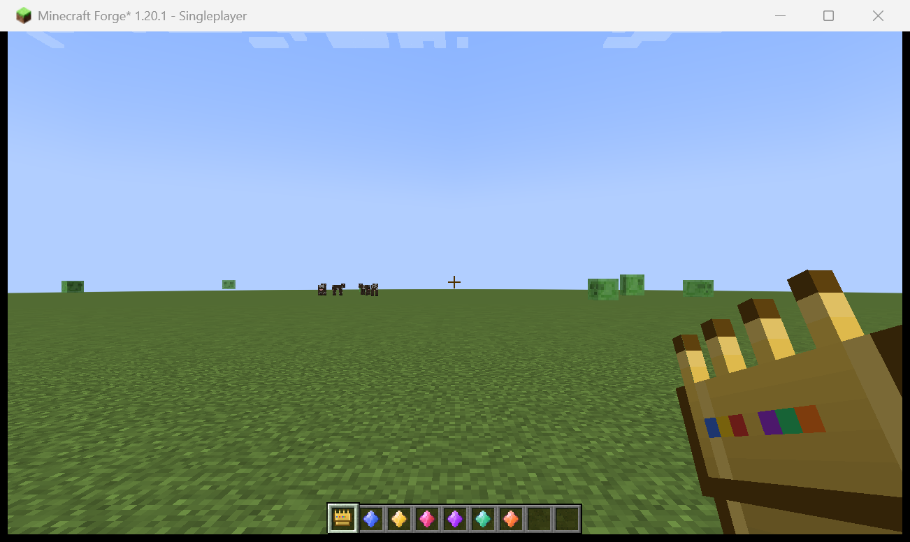
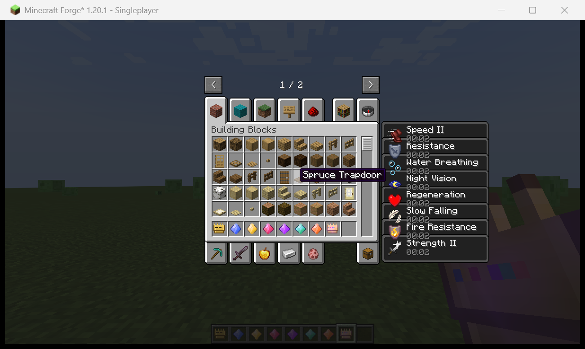
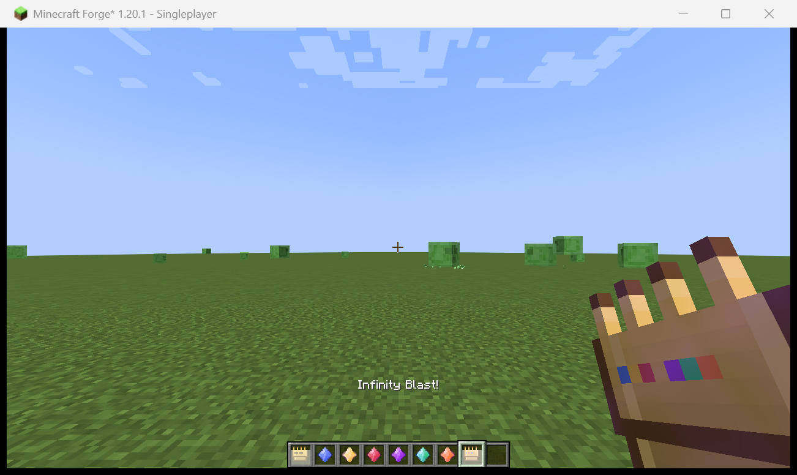
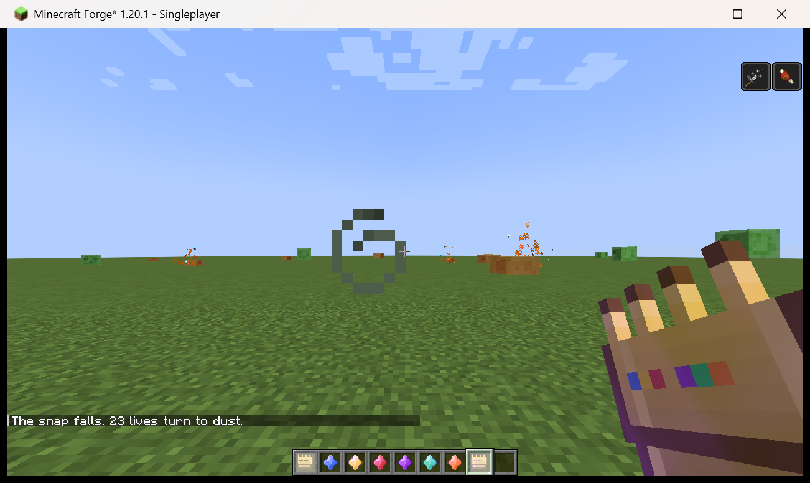

# 无限宝石 · Infinity Stones

Minecraft **1.20.1** · Forge **47.x** · Java **17**

六颗无限宝石 + 一只无限手套。拿在手上就能获得宝石的被动增益，右键释放能力，六颗齐全后潜行右键——打个响指。

---

## 一、操作方式

手套是**手持物品**（主手或副手都行，拿在手里即视为"佩戴"）：

| 操作 | 效果 |
| --- | --- |
| 另一只手拿宝石 + 右键手套 | 把宝石镶嵌进手套（已镶嵌则直接释放该宝石能力） |
| 空手右键 | **无限冲击**：射出一道能量束 |
| 六颗集齐 + **潜行**右键 | **响指**：抹除周围 64 格内一半的生物 |

> 注意：右键**空气**才触发。对着箱子、工作台这类可交互方块右键时，仍然是方块交互（这是原版行为，不影响正常造东西）。

## 二、六颗宝石

| 宝石 | 被动（镶进手套） | 主动（右键） | 冷却 |
| --- | --- | --- | --- |
| 🔵 空间 Space | 缓降 | 向视线方向折跃，最远 26 格，自动找落脚点 | 3s |
| 🟡 心灵 Mind | 夜视 | 半径 20 格内敌对生物获得发光 + 虚弱 + 迟缓 | 10s |
| 🔴 现实 Reality | 抗性提升 | 自身隐身 + 抗性 II + 缓降 12s，周围生物失明 6s | 15s |
| 🟣 力量 Power | 力量 II | 紫色能量炮，穿透直线上所有敌人并点燃 | 5s |
| 🟢 时间 Time | 速度 II | 自身速度 II + 急迫 II，周围生物近乎冻结 6s | 20s |
| 🟠 灵魂 Soul | 生命恢复 | 抽取半径 12 格内生物的生命治疗自己 | 8s |

**六颗齐全**时额外获得：火焰抗性 + 水下呼吸，并且手套开始发光（附魔光效）。

响指之后：玩家获得 30 秒虚弱 II + 饥饿，手套进入 3 分钟冷却，全服广播一句提示。

## 三、合成

**无限手套** —— 金锭 ×6 + 下界合金锭 ×2

```
G N G
G G G
. G .
```

**六颗宝石** —— 每颗都是钻石 ×4 + 1 个核心材料

```
. D .
D X D
. D .
```

| 宝石 | 核心材料 X |
| --- | --- |
| 空间 | 末影之眼 |
| 心灵 | 金苹果 |
| 现实 | 紫水晶碎片 |
| 力量 | 烈焰粉 |
| 时间 | 时钟 |
| 灵魂 | 灵魂灯笼 |

（`G`=金锭　`N`=下界合金锭　`D`=钻石　`.`=空）

## 四、实机验证

以下截图来自 **Minecraft 1.20.1 + Forge 47.2.0 开发客户端**，最后一张贴图对照表由生成器直接输出：

| 截图 | 说明了什么 |
| --- | --- |
|  | 7 个物品全部注册成功，手持手套渲染成 3D 模型，六颗宝石颜色分明 |
|  | 七种镶嵌状态（放大 8 倍）：空手套是六个暗色空宝石座，每镶一颗点亮一颗，镶满后整只手套带附魔光效 |
|  | 八种被动同时生效：速度 II、抗性、水下呼吸、夜视、生命恢复、缓降、火焰抗性、力量 II |
|  | 无限冲击的能量束 |
|  | 响指：`The snap falls. 23 lives turn to dust.` |

实机跑下来还抓出两个**只看代码发现不了**的问题，已修复：

1. **能量束糊脸**：粒子原本从眼前 1 格就生成、单颗尺寸 1.3，右键后整个屏幕被蓝色方块铺满。改成从 2 格之外起、间距 1.2 格、单颗 0.85 尺寸。
2. **空手套看起来像满的**：贴图原来固定画着 6 颗宝石，镶没镶都一样。改成用 `CustomModelData` 标记已镶嵌数量，配套 7 张分级贴图和 6 条模型覆盖规则。

另外确认过：服务端启动零报错、`Loaded 7 recipes`（正好是手套 + 六颗宝石）。

### 手套贴图后来重制过一版

第一版贴图是一块"镶了六个彩点的金砖"——手指只有 1px 粗像天线，金色发闷偏棕，空手套看起来跟镶满一样。重画后的版本：

- **形状**：三根手指（中指比两侧长 1px）、左侧加拇指凸起、掌背挖出两排宝石座、护腕往外扩 1px 并带两颗铆钉
- **配色**：金色整体提亮（`#7C4E0A → #B47A18 → #E8B034 → #FFDA70`），从棕金变成亮金
- **宝石**：每颗 2×2，四角分别打亮/压暗，看起来像球面而不是色块
- **生成方式**：`tools/gen_textures.py` 里的 `GAUNTLET_GRID` 是一张 16×16 字符点阵，改字符就能改造型；`tools/dump_pixels.py` 可以把贴图导成 ASCII 点阵来核对像素

## 五、构建与运行

需要 **JDK 17**（这是 1.20.1 的硬性要求）。

```bash
# Windows
gradlew.bat build

# macOS / Linux
./gradlew build
```

产物：`build/libs/infinitystones-1.0.0.jar`，丢进 `mods/` 文件夹即可。

开发调试直接跑客户端：

```bash
gradlew.bat runClient
```

> 首次构建会从 Forge Maven 下载 Minecraft 并反编译，需要联网，大概十几分钟、约 1GB 磁盘。之后再构建就很快了。
> **国内网络已经预先配好**：`settings.gradle` / `build.gradle` 里加了阿里云 Maven 镜像，`gradle-wrapper.properties` 指向腾讯云 Gradle 镜像（本机直连 `services.gradle.org` 是不通的）。不需要这些镜像就把对应几行删掉。

推荐用 IntelliJ IDEA 打开项目根目录，它会自动识别 Gradle 工程并生成运行配置（`runClient` / `runServer`）。

## 六、目录结构

```
infinitystones/
├── build.gradle                     ForgeGradle 配置
├── gradle.properties                版本号、modid、作者等（改这里最快）
├── settings.gradle
├── gradle/wrapper/                  Gradle Wrapper（来自官方 MDK）
├── docs/screenshots/                实机验证截图
├── tools/
│   ├── gen_textures.py              生成 16x16 物品贴图（纯 Python 无依赖，含 7 张分级手套）
│   ├── check_resources.py           资源自检：JSON / 模型 / 贴图 / 语言键 / 配方
│   ├── mc_ctl.py                    客户端自动化：PrintWindow 截屏 + 发按键/鼠标
│   └── pngcrop.py                   截图裁剪放大（用来核对像素级细节）
└── src/main/
    ├── java/com/moyu/infinitystones/
    │   ├── InfinityStones.java      入口，注册物品 / 标签页 / 事件
    │   ├── item/
    │   │   ├── InfinityStone.java   六颗宝石的枚举（id + 颜色）
    │   │   ├── InfinityStoneItem.java
    │   │   ├── GauntletItem.java    手套的四种交互 + CustomModelData 同步
    │   │   └── GauntletData.java    手套 NBT 读写（已镶嵌哪些宝石）
    │   ├── logic/
    │   │   ├── StonePowers.java     六种能力 + 无限冲击 + 响指
    │   │   └── GauntletEvents.java  手持手套时的被动增益
    │   └── registry/
    │       ├── ModItems.java
    │       └── ModTabs.java
    └── resources/
        ├── META-INF/mods.toml
        ├── pack.mcmeta
        ├── assets/infinitystones/   模型 / 贴图 / 中英文语言文件
        └── data/infinitystones/recipes/   7 个合成配方
```

## 七、想改哪里

| 需求 | 改哪里 |
| --- | --- |
| 加第七颗宝石 | `InfinityStone` 枚举加一项 → `ModItems` 加一行 → 加语言键、模型、贴图、配方 → `StonePowers` 的 `switch` 和 `GauntletEvents` 的 `switch`（**编译器会直接报错提醒你漏了哪个 case**，这是用枚举 + switch 表达式的好处） |
| 调能力强度 / 冷却 | `StonePowers` 里各方法、`cooldownOf()`、`blast()`、`snap()` |
| 调被动效果 | `GauntletEvents.passiveEffect()` / `passiveAmplifier()` |
| 调响指范围 / 概率 | `StonePowers.snap()` 里的 `inflate(64.0D)` 和 `nextBoolean()` |
| 换贴图 | 改 `tools/gen_textures.py` 后重新运行；或直接替换 `textures/item/*.png`（16x16） |
| 改合成表 | `data/infinitystones/recipes/*.json`，改完跑 `python tools/check_resources.py` 自检 |

改完资源后建议跑一次自检，能把"贴图路径写错、语言键漏了、配方产物 id 拼错"这类问题拦下来：

```bash
python tools/check_resources.py
```

## 八、已知取舍

- **手套是手持物品，不是装备槽**。做成胸甲槽就需要自定义盔甲材质和贴图；做成独立装备槽则要额外引入 Curios/Trinkets 依赖。手持是最小依赖、最不会和其他模组冲突的做法。想升级的话，加 Curios 依赖 + 一个 `ICurioItem` 实现即可，能力触发逻辑不用动。
- **数据存在物品 NBT 上**，这是 1.20.1 的标准写法。如果以后要升到 1.21+，需要改成 `DataComponentType`（1.20.5 起 NBT 被组件系统取代）。
- **响指是无差别清除**，只排除玩家。在公共服务器上慎用，宠物和村民也在一半的概率里。
- 目前没有自定义音效（用的是原版音效组合）和进度成就，这两块是纯资源活，随时可以加。
- **`run/` 目录是测试脚手架**（服务端生成的世界、`datapacks/infinitytest/` 自动发放物品的数据包），已被 `.gitignore` 排除，删掉不影响模组本体。
